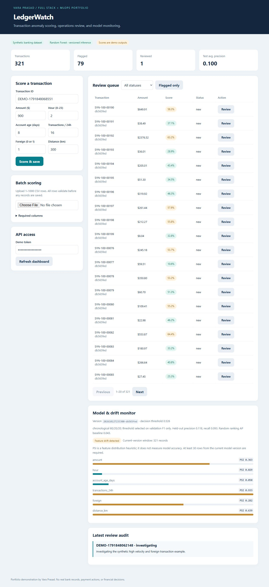
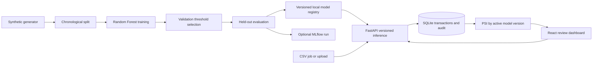

# LedgerWatch — Full-stack transaction anomaly review with MLOps

An end-to-end portfolio application that trains a classifier on synthetic transaction data,
serves versioned predictions through FastAPI, and lets operations users review flagged
records in React. It includes CSV batch inference, experiment tracking, model promotion
and rollback, feature drift monitoring, review audit records, and automated checks.

**Stack:** Python 3.12 · FastAPI · React · TypeScript · Pandas · NumPy · scikit-learn · MLflow · SQLite · Docker · GitHub Actions



## What it demonstrates

- Reproducible synthetic data generation with a fixed seed and explicit label assumptions.
- Chronological train/validation/test split, validation-only threshold selection, and held-out metrics.
- Random Forest classifier with feature importance and an average precision baseline.
- Immutable version directories with model artifacts and metadata; an atomic active-version pointer.
- Online scoring and whole-request atomic CSV batch scoring with bounded upload size and schema validation.
- Review queue with filters, pagination, optimistic record versions, and required review reasons.
- Optional MLflow run tracking for training parameters, metrics, and artifact bundles.
- Population Stability Index (PSI) over the latest 1000 records scored by the active model.
- Prometheus-compatible request/error/scoring counters, Docker health checks, and GitHub Actions CI.

## Run it

```sh
docker compose up --build
```

Open http://localhost:8080. The first backend startup trains a small demo model and seeds
120 synthetic transactions; later startups reuse the persistent model and database.
The UI token is `demo-ledger-token`. For native setup see [SETUP](docs/SETUP.md).

## Architecture



## Five-minute demo

1. Inspect the seeded review queue and select **Flagged only**.
2. Score the prefilled synthetic transaction. A score, flag, and model version are saved.
3. Open a transaction review, enter a reason, and save `investigating`.
4. Confirm the review audit entry and updated queue status.
5. Generate and upload a shifted CSV as shown below. Inspect the feature drift monitor.

## Train, track, promote, and roll back

From `backend`, using your virtual environment (`.venv\Scripts\python.exe` in place of
`python` on Windows if the environment is not activated):

```sh
python train.py --track --candidate --seed 17
```

The command prints the new version and held-out metrics. Candidate training does not
change the active model. Review `runtime/models/VERSION/metadata.json` before promotion.

```sh
python train.py --promote NEW_VERSION
```

To roll back, promote a previously generated version:

```sh
python train.py --promote PREVIOUS_VERSION
```

The API reloads the active model on the next request; no application restart is necessary.
Prediction and recorded version are captured under one in-process lock.
This is a **local file registry**; it is not the MLflow Model Registry. MLflow logs run
parameters, test metrics, and the model bundle as artifacts. Its tracking URI defaults
to a local `runtime/mlruns` folder and can be set with `MLFLOW_TRACKING_URI`.

`mlflow-skinny` provides the tracking client. To run a local MLflow UI, install full
`mlflow==2.22.0` separately and run `mlflow ui --backend-store-uri runtime/mlruns` from
backend. The full UI dependency and a remote tracking server are optional.

## CSV batch inference and drift

```sh
python generate_batch.py --rows 100 --seed 99 --output runtime/normal.csv
python batch_score.py runtime/normal.csv
python generate_batch.py --drift --rows 200 --seed 100 --output runtime/shifted.csv
python batch_score.py runtime/shifted.csv
```

Alternatively upload these files from the dashboard. Use a new seed to generate new IDs;
reusing transaction IDs returns 409 and rolls back the entire upload. A ready-to-upload
small example is in [sample-batch.csv](data/sample-batch.csv).

The generator's `--drift` option shifts feature distributions. It demonstrates a monitoring
signal, not a real change in bank activity. PSI above 0.2 triggers an illustrative alert.
Fewer than 30 current-version rows produce no drift calculation. PSI is not an accuracy
measurement or a guarantee that model performance degraded.

## Model evaluation

The 5000 synthetic records split into 3000 training, 1000 validation, and 1000 test rows.
The threshold maximizes validation F1. Test precision, recall, F1, ROC AUC, and average
precision are reported after threshold selection. Positive label prevalence is the expected
average precision for random ranking. Synthetic labels are probabilistic and imperfect;
the scores are not calibrated fraud probabilities. No real-world accuracy is claimed.

The dataset has no real customer/account histories. A real implementation would need
entity-aware and time-aware splits, feature freshness checks, outcome labels, and cost-based
thresholds. The demo avoids target leakage by keeping labels and event IDs out of model features.

## API

Use http://localhost:8000/docs and authorize with the demo API token.

| Endpoint | Purpose |
| --- | --- |
| `POST /score` | Validate, score, and persist one transaction |
| `POST /batch` | CSV upload, at most 1 MB and 1000 rows |
| `GET /transactions` | Filter by flag/status and paginate |
| `PATCH /transactions/{id}/review` | Status, reason, and expected record version |
| `GET /model` | Current model metadata and test metrics |
| `GET /monitoring` | Counts, review audit, and feature PSI |
| `GET /health`, `GET /metrics` | Health and service metrics |

## Verify

From `backend`:

```sh
python -m pytest -q
```

From `frontend`:

```sh
npm ci
npm run build
```

See [validation notes](docs/VALIDATION.md) for the checks actually performed.
CI also builds Docker images. Docker Compose definitions are provided; a remote/cloud
deployment is not part of this project.

## Repository map

```text
backend/app/          data generator, training, registry, API, persistence
backend/tests/        ML, scoring, batch atomicity, review, drift, rollback tests
backend/train.py      training/tracking/promotion CLI
backend/generate_batch.py
backend/batch_score.py
data/sample-batch.csv synthetic upload example
frontend/src/        React dashboard
docs/                setup, demo, validation, publication
.github/workflows/   CI checks
compose.yaml         local container stack
```

## Scope

This project uses only invented transaction records and labels. Review statuses are
portfolio workflow outputs. No real bank systems or payment actions are connected.
Demo tokens are intended for local use; production would require proper identity,
role controls, protected monitoring endpoints, managed database migrations, and deployment
operations. Only locally generated/trusted model bundles should be loaded: joblib uses
Python object deserialization. The project does not expose artifact upload endpoints.

SQLite and a local model registry keep the demo easy to run. PostgreSQL, Airflow, cloud
storage, Kubernetes, and Grafana are potential extensions, not implemented claims.

See [demo/interview notes](docs/DEMO.md) and [publishing instructions](docs/PUBLISH.md).

**GitHub description:** FastAPI and React transaction anomaly review app with reproducible ML training, MLflow tracking, versioned inference, CSV scoring, and drift monitoring.

**Topics:** `python` `fastapi` `react` `typescript` `machine-learning` `mlops` `mlflow` `scikit-learn`

## Technical references

- [scikit-learn precision/recall metrics](https://scikit-learn.org/stable/modules/generated/sklearn.metrics.precision_recall_curve.html)
- [MLflow experiment tracking](https://mlflow.org/docs/latest/tracking/)
- [FastAPI file uploads](https://fastapi.tiangolo.com/tutorial/request-files/)

MIT licensed. Created for Vara Prasad's independent engineering portfolio.
